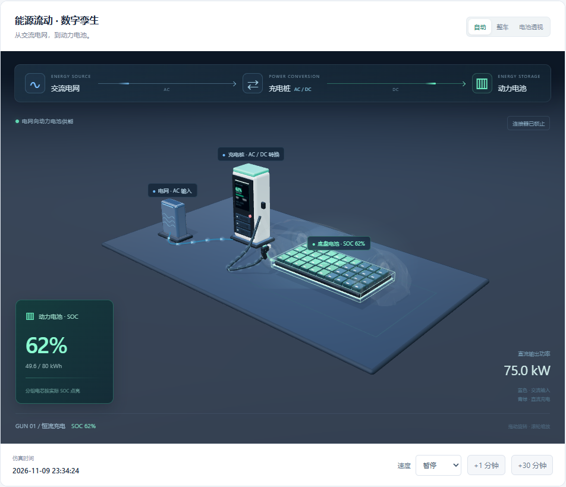
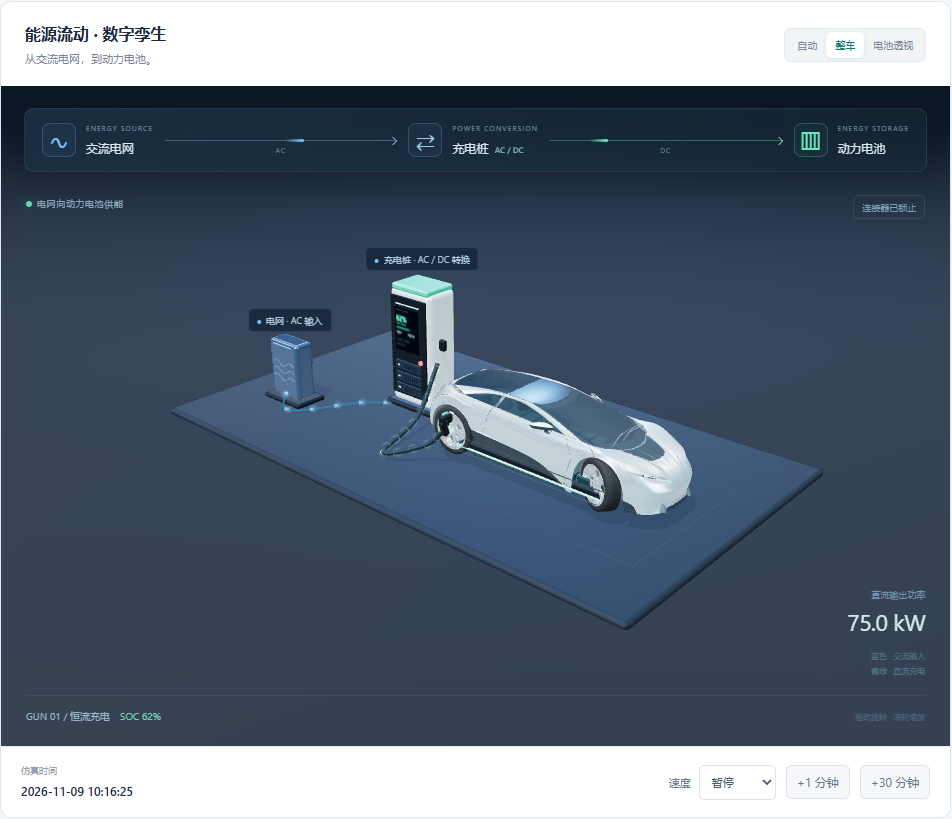

# 充电数字孪生：3D视觉升级

## 完整视觉描述

设计一个具有工业产品展示质感的电动汽车充电数字孪生场景。采用金属车身、连续曲面、细节轮毂、玻璃座舱与柔和棚拍光，配合具有屏幕、模块抽屉、散热格栅和指示灯的直流充电桩。以明确的方向关系展示“电网交流供电→充电桩AC/DC转换→线缆直流传输→底盘动力电池储能”。插枪动作经过缓慢提枪、移动、对准与插入，约3.6秒完成；拔枪反向平滑回位。充电开始后，车身和车轮渐隐为半透明轮廓，突出保持实体的底盘电池包；电芯按模拟器真实SOC成组点亮，电池旁显示SOC、估算已存储电量与额定容量。用蓝色标识交流侧、青绿色标识直流侧，通过连续方向粒子表达能量传输。停机或故障时能流立即停止，保留整车/电池透视视图切换，便于观察外观与储能状态。

## 已实现的交互

- 自动：有实际输出电压、电流、充电状态且连接器就位后，启动能流和车身透视。
- 整车：充电过程中也能恢复不透明外观；展示模式不会影响业务充电状态。
- 电池透视：待机也能查看底盘电池，待机不显示虚假的充电能流。
- 插拔枪：3.6秒缓动，最后阶段缓慢插入/抽离；连接器未就位时，界面发起的启机等待动作完成。
- 急停/本地停止等保护动作不等待插枪动画。切换枪号时，待发命令仍使用点击时的枪号。
- 动画完成计时独立于浏览器渲染帧率，页面切换到后台也不会让界面命令永久等待。
- 优先减少动态效果的用户，插拔枪缩短至约0.4秒，方向图停止循环动画。
- 模型、依赖、许可均本地打包，运行时不请求外部模型网站。

## 数据与表现

SOC、容量、输出电压、电流、状态、故障和插枪状态取自模拟器 `simulator-state` 事件。存储电量展示为 `SOC × 电池容量` 的估算值。40组电芯是SOC可视化分组，不表示真实车辆的电芯数量或逐电芯BMS测量。

蓝色AC输入和青绿色DC输出为能量方向示意；不伪造电网侧实测功率、转换效率或损耗。动画时间不改变协议时间、费率、订单、电量或账单。

## 几何与资产

- 车辆：Car Concept外观几何，由Eric Chadwick / Darmstadt Graphics Group GmbH于2024年制作，CC BY 4.0。
- 来源：https://github.com/KhronosGroup/glTF-Sample-Assets/tree/main/Models/CarConcept
- 派生文件：`static/assets/car-concept/neutral-ev.glb`，约4.23MB。
- 修改：剔除原始贴图、标识/牌照、内饰和发动机；重设中性车漆、玻璃、轮胎、灯具材质；单独接入底盘电池包和充电口。这里是通用电动车展示，不表示来源概念车本身是某款量产电动车。
- 署名、完整许可、来源及修改说明：同目录 `ATTRIBUTION.md`、`CC-BY-4.0.txt`、`ASSET-MANIFEST.json`；页面底部提供署名入口。
- 原创部分：充电桩、电网节点、线缆、连接器、电池包、能流及状态联动。
- Three.js固定0.180.0；使用GLTFLoader、RoomEnvironment、RoundedBoxGeometry、OrbitControls，均随MIT许可本地化。

## 性能处理

40组电芯和端子分别采用InstancedMesh批量渲染，避免每组多个独立网格带来的绘制开销。方向粒子复用几何与材质；插拔期间才重建线缆；电池与车身透明度渐变独立于后端计费。阴影仅在模型加载、插拔枪或透视切换时更新；隐藏页面及滚出视野后停止渲染；避免重复写入未变化的DOM文本。

## 验证

`scripts/verify-scene-v2.cjs`对隔离模拟器执行实际插枪、启动、故障和展示模式操作，并生成 `scene-v2-browser-checks.json`。可设置环境变量SCENE_TEST_URL切换测试目标。脚本会修改目标实例状态。

预览：

