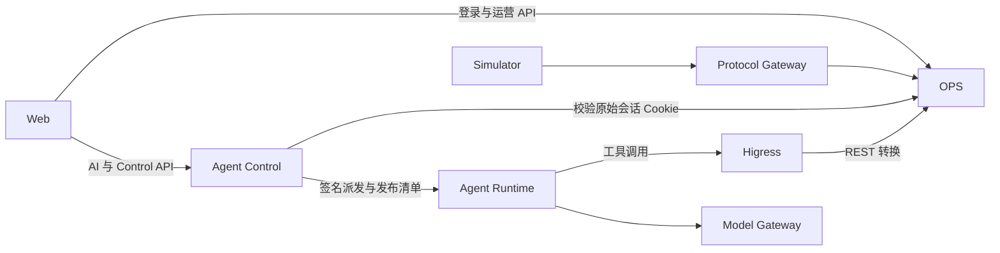

# 模块与组件治理

本轮以六个后端应用、一个前端和四个内部共享库组织。所有目录和 Maven artifact 恢复 `iot-protocol-expert` 前缀；根 artifact 为 `iot-protocol-expert`。共享库位于 `shared/`，不独立部署。

## 应用边界

| 应用 | 端口 | 职责 |
| --- | --- | --- |
| iot-protocol-expert-ops | 19082 | 登录会话、用户角色权限、设备、订单、费率、遥测、协议文档、业务内部接口 |
| iot-protocol-expert-agent-control | 19083 | 租户项目与作用域授权、会话、知识、Agent/MCP/Skill 组件与版本、发布和调度 |
| iot-protocol-expert-agent-runtime | 19084 | 装配指定发布版本、执行工具、上报事件和检查点；不访问业务数据库 |
| iot-protocol-expert-protocol-gateway | 19080 | TCP/WebSocket/MQTT/Modbus 接入与协议处理；不保存业务事实 |
| iot-protocol-expert-simulator | 19081 | 场景复现、设备状态机、故障注入与仿真快照 |
| iot-protocol-expert-model-gateway | 19085 | 供应商凭据、模型路由、配额预占结算与用量审计 |
| iot-protocol-expert-web | 5173 | 同源前端入口；按路径分流 OPS 与 Agent Control |

OPS 的 Java 包为 `top.yealike.pep.ops`，Agent 控制面保留 `top.yealike.pep.control`，避免跨模块混放同名配置。其余 Java 包和 Maven groupId 保持兼容。模拟器通过共享编解码和观测库工作，不依赖网关应用 JAR。应用均输出普通名称的可执行 JAR，无需 `-exec` 分类器。

### Agent Control 内部包

`iot-protocol-expert-agent-control` 按“HTTP 适配、业务功能、存储适配、外部集成”分层；`src/main/resources/mapper` 与 Java 功能包同名，避免所有 XML 混在 `mapper/ai`。

| 包 / 目录 | 职责 |
| --- | --- |
| `api.ai`、`api.ai.admin`、`api.internal`、`api.control` | 用户、管理员和内部 HTTP 契约；不承载业务规则 |
| `api.*.dto` | HTTP 请求体等传输结构；与 Controller 相邻放置但在独立叶子包中维护 |
| `agents` | Agent、MCP、Skill、模型、凭据、发布与注册投影；`agents.domain` 只放跨包使用的领域记录 |
| `runs` | Run 生命周期、调度、Runtime 回调、事件广播和历史 |
| `conversations` | 会话与消息持久化；不反向依赖 Run |
| `knowledge` | 协议文档索引与检索 |
| `access` | 用户身份、站点范围和 `access.policy` 授权策略 |
| `integration` | OPS、Runtime、Nacos 和 MCP 网关等外部适配器 |
| `config`、`config.properties`、`audit`、`mybatis`、`support`、`observability` | 基础设施配置；`config.properties` 只放 Spring 配置绑定记录 |

依赖方向固定为 `api -> 功能服务 -> store/mapper`，跨功能只允许调用明确的应用服务；外部系统调用只能放在
`integration`。Mapper 只依赖叶子 `domain` 包中的行记录（如 `agents.domain`、`knowledge.domain`、
`access.policy.domain`），不得反向依赖 Service、Store 或 Repository。`agents` 不依赖 `runs`；会话详情所需的
当前 Run 由 `runs.ConversationRunViewService` 组装，避免 `conversations` 与 `runs` 双向引用。
`ConversationChannels` 属于 Run 事件广播，保留在 `runs`。

各功能包遵循同一归置规则：领域模型、查询行和服务结果放 `domain`，HTTP 或外部传输结构放 `dto`，
Spring 配置绑定放 `config.properties`；Controller、Service、Store、Mapper 等主体代码不再内嵌公共 record。
仅在强耦合且不跨包使用时，才允许保留 private 内部 record。

### Agent Runtime 内部包

`iot-protocol-expert-agent-runtime` 按“HTTP 入口、Control 适配、Run 执行、能力装配、基础设施”分层；
跨应用契约继续放在 `shared/iot-protocol-expert-*`，不复制到运行时功能包。

| 包 / 目录 | 职责 |
| --- | --- |
| `api`、`api.dto` | Runtime 内部 HTTP 契约（run/cancel）与请求体；不承载执行规则 |
| `control`、`control.dto` | Control 客户端、签名异常与期望发布分页结果 |
| `execution`、`execution.domain` | Run 准入、执行编排、事件发布与审计证据；`domain` 放终态结果、工具计时和额度失败原因 |
| `prepare`、`prepare.domain` | 发布清单校验、冻结工具与注册表；`domain` 放可跨包共享的准备结果 |
| `mcp`、`mcp.domain` | MCP 连接池、工具适配与返回 envelope |
| `skill`、`registry`、`readiness`、`observability` | Skill 读取、Nacos 注册、就绪检查与 OTel 接入 |
| `config`、`config.properties` | Web、安全和线程池配置；`config.properties` 只放 Spring 配置绑定记录 |

依赖方向固定为 `api -> execution/prepare -> control/mcp/skill -> config`；`execution` 不感知 Control 的 HTTP
细节，外部调用收敛在 `control`。`RunEventPublisher.QueuedEvent`、`PreparedReleaseRegistry.SchemaFailure`
只在所属类内部使用，保留为 private 内部 record。

### Model Gateway 内部包

`iot-protocol-expert-model-gateway` 按“HTTP 适配、模型调用、目录、额度、基础设施”分层；OpenAI 兼容入口
与平台管理入口都留在 `api`，业务规则由功能服务承担。

| 包 / 目录 | 职责 |
| --- | --- |
| `api.admin`、`api.chat`、`api.quota` | 管理、OpenAI 兼容调用与额度 HTTP 契约；只做参数转换和响应封装 |
| `catalog`、`catalog.domain`、`catalog.dto`、`catalog.mapper` | 供应商与逻辑模型目录；`domain` 放行记录和路由结果，`dto` 放管理请求体 |
| `chat`、`chat.domain` | 模型调用准备、供应商请求与用量归一；`domain` 放已准备调用和上游响应 |
| `quota`、`quota.domain`、`quota.dto`、`quota.mapper` | 配额账户、预占、结算与用量审计；`domain` 放账本行和视图，`dto` 放管理请求体 |
| `auth`、`config.properties`、`mybatis`、`support` | 运行凭据校验、Spring 配置绑定、类型处理器与 API 异常 |

目录与额度服务不直接暴露 mapper 行结构；HTTP 请求体集中在 `dto`，Spring 配置绑定集中在
`config.properties`。`QuotaService.BucketAndAccount` 只服务单次额度计算，保留为 private 内部 record。

### OPS 内部包

`iot-protocol-expert-ops` 按“HTTP 适配、业务功能、存储适配、基础设施”分层；业务功能包内部再按
`domain / dto / mapper / service` 归置，Controller 不再内嵌请求或响应 record。

| 包 / 目录 | 职责 |
| --- | --- |
| `api.admin`、`api.admin.dto`、`api.internal`、`api.internal.dto`、`api.simulator`、`api.simulator.dto`、`api.dto` | 运营后台、内部服务与模拟器 HTTP 契约；只做参数转换和响应封装 |
| `access`、`access.domain`、`access.mapper`、`access.service` | 用户身份、角色权限、会话校验与账号管理 |
| `devices`、`devices.domain`、`devices.dto`、`devices.mapper`、`devices.service` | 设备档案、枪口、产品、第三方映射、协议文档与物模型 |
| `devices.thingmodel`、`devices.thingmodel.domain` | 物模型编解码与值类型转换；`domain` 只放模型和值类型契约 |
| `charging`、`charging.domain`、`charging.dto`、`charging.mapper`、`charging.service` | 订单、账单、费率模型与设备命令记录 |
| `telemetry`、`telemetry.domain`、`telemetry.mapper`、`telemetry.service` | 订单时序写入 TDengine、outbox 补写与查询 |
| `diagnostic`、`diagnostic.domain`、`diagnostic.mapper`、`diagnostic.service` | 报文解码、模型摘要与排障记录 |
| `audit`、`audit.domain`、`audit.mapper`、`audit.service` | 审计日志 |
| `config`、`config.properties`、`config.security`、`support.page` | Spring 配置绑定、安全过滤链与分页排序工具 |

依赖方向固定为 `api -> 功能服务 -> mapper`；`domain` 是叶子包，只被服务和 mapper 引用，不反向依赖
Service、Controller 或编解码器。OPS 的 OpenAPI 配置注册 `sessionCookie`、`opsServiceToken` 和
`simulatorToken` 三个安全方案，分别用于浏览器会话、`/internal/**` 与 `/api/ops/simulator/**`。

### Protocol Gateway 内部包

`iot-protocol-expert-protocol-gateway` 按“接入协议、设备身份、命令编排、外部集成”分层，协议实现之间不共享
会话状态。

| 包 / 目录 | 职责 |
| --- | --- |
| `api`、`api.dto` | 协议目录、报文解码和内部命令 HTTP 契约 |
| `protocol`、`protocol.ykc`、`protocol.ocpp16` | 协议服务器抽象、云快充 TCP 与 OCPP 1.6J WebSocket 接入 |
| `device` | 设备身份注册、在线目录与设备快照 |
| `command`、`command.dto` | 通道命令编排、超时控制与结果归一 |
| `integration.ops`、`integration.ops.dto` | OPS 内部接口客户端与传输记录 |
| `config`、`config.properties`、`support.dto` | 帧留存、运行参数绑定、OpenAPI 与统一错误响应 |

`protocol.*` 不直接访问 OPS，设备和订单事实统一通过 `integration.ops` 回传；`command` 只依赖协议抽象，
不感知具体 Netty Channel 或 WebSocket Session。

### Simulator 内部包

`iot-protocol-expert-simulator` 按“HTTP 入口、仿真运行时、外部集成、状态持久化”分层；设备状态机与 OCPP
客户端集中在 `runtime`。

| 包 / 目录 | 职责 |
| --- | --- |
| `api`、`api.dto` | 交互模拟、并发模拟、平台代理 HTTP 契约 |
| `runtime` | 枪状态机、并发车队、OCPP WebSocket 客户端与待处理交易 |
| `domain` | 协议枚举、枪状态、报文日志与设备键等纯数据模型 |
| `integration.ops`、`integration.ops.dto` | OPS 设备目录、费率与命令客户端 |
| `mapper`、`mapper/dto` | 仿真状态持久化与数据库行记录 |
| `config`、`config.properties`、`support.dto` | 运行参数绑定、OpenAPI 与统一错误响应 |

`runtime` 不依赖 `api`，HTTP 层只负责把请求翻译成运行时命令；需要访问 OPS 时统一走 `integration.ops`。

## MCP / Skill 的权威来源

| 对象或能力 | 负责组件 |
| --- | --- |
| MCP 草稿、连接测试、工具 schema 快照、只读审核、发布版本、依赖绑定 | Control + PostgreSQL |
| Skill 文件、校验、版本、bundle 摘要、发布与分发 | Control + PostgreSQL |
| Agent 编译清单、绑定的 MCP/Skill 精确版本、发布/回滚意图、审计 | Control + PostgreSQL |
| REST-to-MCP、MCP 协议入口、路由及网关访问策略 | Higress |
| 进程注册发现 | Nacos Naming（可选） |
| 发布清单的执行与摘要校验 | Runtime |

Control 不再向 Nacos 注册 MCP/Skill 版本，也不因缺少这类 Naming 实例阻塞发布。组件诊断使用平台发布状态。Runtime 使用已发布描述符中的固定 endpoint，忽略旧的 MCP `serviceName` 发现元数据；已有发布快照可继续使用。Agent 发布和派发走配置的单个 Runtime 地址，发布以 Runtime 返回的准备结果为准。

Higress 支持直接配置 REST-to-MCP，无需把 Nacos AI Registry 作为前置条件：[Higress MCP Server 插件](https://higress.cn/en/docs/ai/mcp-server/)。Nacos 本身也有 MCP/Skill 版本管理能力，但本项目选择由业务平台统一治理，避免两个管理入口分别维护版本：[Nacos MCP Registry](https://nacos.io/en/docs/latest/manual/user/ai/mcp-registry/)。

发布时应绑定明确版本和 schema/bundle 摘要。Higress 路由建议包含版本（例如 `/mcp/ops/v1`）；改变工具 schema 或 REST 映射时发布新路由和 MCP 版本，再重新测试、审核、发布 Agent。平台冻结 endpoint 和工具快照并不能阻止运维人员原地修改同一条网关路由，网关变更仍需遵循这条发布约定。

## 旧 Nacos 资源过渡

1. 保留 Nacos 上的现有配置和本地数据库发布记录，本轮不对外部环境做清理或部署。
2. 在 Higress 中独立配置 REST-to-MCP 路由，验证初始化和 `tools/list`。原生插件配置示例见 `infra/higress/README.md`。
3. 新建 MCP 使用 `REMOTE`，填写实际 Higress Streamable HTTP endpoint。平台测试、审核工具并发布版本。
4. 旧 `NATIVE_REGISTRY` 草稿可在原记录补充 endpoint；原始目录引用留作来源记录。有显式 endpoint 后不再查询 Nacos 目录，重新测试发布即可。旧 ACTIVE 发布仍使用原冻结 endpoint。
5. `NacosMcpCatalogService` 仅作为显式开启的只读迁移适配器：`ipe.ai.legacy-nacos-catalog-enabled=true`，默认关闭；新建组件不接受 `NATIVE_REGISTRY`。
6. 系统级知识索引所用 OPS 工具入口通过 `IPE_AI_MCP_URL` 或 `IPE_AI_MCP_GATEWAY_BASE` 配置，取消原 Nacos AI 目录订阅。后者兼容已有 `/ipe-mcp/{serverName}` 路由；自定义版本路由优先使用完整 URL。
7. 确认所有部署已切换后，再由运维安排删除 Nacos 中的旧 MCP/Skill 条目。

平台本轮不自动向 Higress 下发配置。后续若实现发布适配器，需要记录网关配置摘要、应用结果与回滚状态，不能把数据库 ACTIVE 直接等同于网关配置已生效。

## 数据库与会话迁移

OPS 通过 `pep_platform.flyway_schema_history` 管理平台、运营和 Agent Control 的迁移。V8 移除已退役调查任务的角色权限，历史 V3 迁移及调查记录仍保留。Control 关闭 Flyway，使用同一个数据库中的 `pep_platform` 和 `pep_agent`。Control 管理租户项目，OPS 管理用户身份，两者共享数据库中的身份和授权信息。

后续独立拆库时，需要单独设计身份授权投影和迁移基线，不能直接移动/改名历史迁移或开启另一套 Flyway 对已有版本重复执行。模型网关和模拟器继续保留自己的数据库连接与 Flyway 历史。

浏览器登录仍由 OPS 创建会话。Control 不另建会话，每次用户 API 请求把原始 Cookie 交给 OPS 内部身份接口校验；内部接口要求 `X-Ops-Service-Token`。SSE 周期性重新验证原会话，失效后关闭流。生产同源反向代理需把 `/api/ai`、`/api/control` 转到 Control，其他运营 API 和登录转到 OPS，示例见 `infra/web-nginx.conf.example`。

## 本地升级

- 使用 JDK 21，在根目录执行 `mvn -Pcoding-guidelines verify`；前端执行 `npm ci` 和 `npm run build`。
- 旧版本运行中的后端需先使用对应旧脚本停止，再运行新版本脚本，避免旧进程继续占用 19082。新脚本不会按端口强杀未知进程。
- `.env.local` 按 `.env.example` 更新：OPS 19082、Control 19083；`IPE_OPS_BASE_URL` 与 `IPE_CONTROL_BASE_URL` 分别指向对应进程。
- 本地脚本只迁移上版内置的本机端口与服务名，不改写秘密文件；IDE 启动需自行更新旧环境变量。
- 通过 `IPE_AGENT_RUNTIME_BASE_URL` 配置单个 Runtime 地址，本地和 Compose 已提供默认配置。
- 先启动 OPS，再启动 Control、模型网关、Runtime、协议网关和模拟器。`scripts/start-local.ps1` 按此顺序执行。
- 只启动 AI 相关本地服务时运行 `scripts/seed-ai.ps1`。MCP 入口和 Agent 版本在平台配置与发布。

2026-11-18 已完成本地真实 PostgreSQL、Higress/Nacos、真实模型与 Agent/Trace 全流程验收；剩余外部部署迁移及长时故障/压力矩阵。
