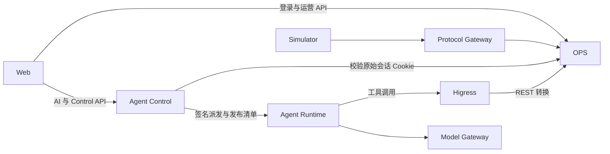

# 模块与组件治理

本轮以六个后端应用、一个前端和四个内部共享库组织。所有目录和 Maven artifact 恢复 `iot-protocol-expert` 前缀；根 artifact 为 `iot-protocol-expert`。共享库位于 `shared/`，不独立部署。

## 应用边界

| 应用 | 端口 | 职责 |
| --- | --- | --- |
| iot-protocol-expert-ops | 19082 | 登录会话、用户角色权限、设备、订单、费率、遥测、协议文档、业务内部接口 |
| iot-protocol-expert-agent-control | 19083 | 租户项目与作用域授权、调查任务、会话、知识、评测、Agent/MCP/Skill 组件与版本、发布和调度 |
| iot-protocol-expert-agent-runtime | 19084 | 装配指定发布版本、执行工具、上报事件和检查点；不访问业务数据库 |
| iot-protocol-expert-protocol-gateway | 19080 | TCP/WebSocket/MQTT/Modbus 接入与协议处理；不保存业务事实 |
| iot-protocol-expert-simulator | 19081 | 场景复现、设备状态机、故障注入与仿真快照 |
| iot-protocol-expert-model-gateway | 19085 | 供应商凭据、模型路由、配额预占结算与用量审计 |
| iot-protocol-expert-web | 5173 | 同源前端入口；按路径分流 OPS 与 Agent Control |

OPS 的 Java 包为 `top.yealike.pep.ops`，Agent 控制面保留 `top.yealike.pep.control`，避免跨模块混放同名配置。其余 Java 包和 Maven groupId 保持兼容。模拟器通过共享编解码和观测库工作，不依赖网关应用 JAR。应用均输出普通名称的可执行 JAR，无需 `-exec` 分类器。

## MCP / Skill 的权威来源

| 对象或能力 | 负责组件 |
| --- | --- |
| MCP 草稿、连接测试、工具 schema 快照、只读审核、发布版本、依赖绑定 | Control + PostgreSQL |
| Skill 文件、校验、版本、bundle 摘要、发布与分发 | Control + PostgreSQL |
| Agent 编译清单、绑定的 MCP/Skill 精确版本、发布/回滚意图、审计 | Control + PostgreSQL |
| REST-to-MCP、MCP 协议入口、路由及网关访问策略 | Higress |
| 进程注册发现、Runtime 已装配版本的实例发现 | Nacos Naming（可选） |
| 发布清单的执行与摘要校验 | Runtime |

Control 不再向 Nacos 注册 MCP/Skill 版本，也不因缺少这类 Naming 实例阻塞发布。组件诊断使用平台发布状态。Runtime 使用已发布描述符中的固定 endpoint，忽略旧的 MCP `serviceName` 发现元数据；已有发布快照可继续使用。Agent 的 Runtime 实例注册仍表示“该进程已装配此版本”，不保存组件内容，也不决定默认版本。

Higress 支持直接配置 REST-to-MCP，无需把 Nacos AI Registry 作为前置条件：[Higress MCP Server 插件](https://higress.cn/en/docs/ai/mcp-server/)。Nacos 本身也有 MCP/Skill 版本管理能力，但本项目选择由业务平台统一治理，避免两个管理入口分别维护版本：[Nacos MCP Registry](https://nacos.io/en/docs/latest/manual/user/ai/mcp-registry/)。

发布时应绑定明确版本和 schema/bundle 摘要。Higress 路由建议包含版本（例如 `/mcp/ops/v1`）；改变工具 schema 或 REST 映射时发布新路由和 MCP 版本，再重新测试、审核、发布 Agent。平台冻结 endpoint 和工具快照并不能阻止运维人员原地修改同一条网关路由，网关变更仍需遵循这条发布约定。

## 旧 Nacos 资源过渡

1. 保留 Nacos 上的现有配置和本地数据库发布记录，本轮不对外部环境做清理或部署。
2. 在 Higress 中独立配置 REST-to-MCP 路由，验证初始化和 `tools/list`。原生插件配置示例见 `infra/higress/README.md`。
3. 新建 MCP 使用 `REMOTE`，填写实际 Higress Streamable HTTP endpoint。平台测试、审核工具并发布版本。
4. 旧 `NATIVE_REGISTRY` 草稿可在原记录补充 endpoint；原始目录引用留作来源记录。有显式 endpoint 后不再查询 Nacos 目录，重新测试发布即可。旧 ACTIVE 发布仍使用原冻结 endpoint。
5. `NacosMcpCatalogService` 仅作为显式开启的只读迁移适配器：`ipe.ai.legacy-nacos-catalog-enabled=true`，默认关闭；新建组件不接受 `NATIVE_REGISTRY`。
6. 系统级知识索引所用 OPS 工具入口通过 `IPE_AI_MCP_URL` 或 `IPE_AI_MCP_GATEWAY_BASE` 配置，取消原 Nacos AI 目录订阅。后者兼容已有 `/ipe-mcp/{serverName}` 路由；自定义版本路由优先使用完整 URL。
7. 确认所有部署已切换后，再由运维安排删除 Nacos 中的旧 MCP/Skill 条目。

平台本轮不自动向 Higress 下发配置。后续若实现发布适配器，需要记录网关配置摘要、应用结果与回滚状态，不能把数据库 ACTIVE 直接等同于网关配置已生效。

## 数据库与会话迁移

本轮先拆分应用，不迁移数据库或重写已执行 SQL。历史 `V1__pep_control_baseline.sql`、`V2__platform_access.sql`、`V3__investigations.sql` 原样放在 OPS，继续使用原 `pep_platform.flyway_schema_history`。当前新增 `V4__ocpp_transaction_uniqueness.sql` 和 `V5__active_charge_order_uniqueness.sql`，OPS 按 V1–V5 执行。Control 关闭重复 Flyway，使用同一个数据库中的现有 `pep_platform` / `pep_agent` 表。租户项目管理在 Control，用户身份由 OPS 管理；数据库层仍有共享身份/授权读取。两者还不能直接配置为互不相关的独立数据库。

后续独立拆库时，需要单独设计身份授权投影和迁移基线，不能直接移动/改名历史迁移或开启另一套 Flyway 对已有版本重复执行。模型网关和模拟器继续保留自己的数据库连接与 Flyway 历史。

浏览器登录仍由 OPS 创建会话。Control 不另建会话，每次用户 API 请求把原始 Cookie 交给 OPS 内部身份接口校验；内部接口要求 `X-Ops-Service-Token`。SSE 周期性重新验证原会话，失效后关闭流。生产同源反向代理需把 `/api/ai`、`/api/control` 转到 Control，其他运营 API 和登录转到 OPS，示例见 `infra/web-nginx.conf.example`。

## 本地升级

- 使用 JDK 21，在根目录执行 `mvn -Pcoding-guidelines verify`；前端执行 `npm ci` 和 `npm run build`。
- 旧版本运行中的后端需先使用对应旧脚本停止，再运行新版本脚本，避免旧进程继续占用 19082。新脚本不会按端口强杀未知进程。
- `.env.local` 按 `.env.example` 更新：OPS 19082、Control 19083；`IPE_OPS_BASE_URL` 与 `IPE_CONTROL_BASE_URL` 分别指向对应进程。
- 本地脚本只迁移上版内置的本机端口与服务名，不改写秘密文件；IDE 启动需自行更新旧环境变量。
- 无 Nacos 的本地运行显式设置 `IPE_RUNTIME_DIRECT_FALLBACK_ENABLED=true`；部署环境按路由策略配置。
- 先启动 OPS，再启动 Control、模型网关、Runtime、协议网关和模拟器。`scripts/start-local.ps1` 按此顺序执行。
- 需要种子发布时运行 `scripts/seed-ai.ps1`，提前配置可访问的 Higress MCP 入口。

2026-11-18 已完成本地真实 PostgreSQL、Higress/Nacos、真实模型与 Agent/Trace 全流程验收；剩余外部部署迁移及长时故障/压力矩阵。
