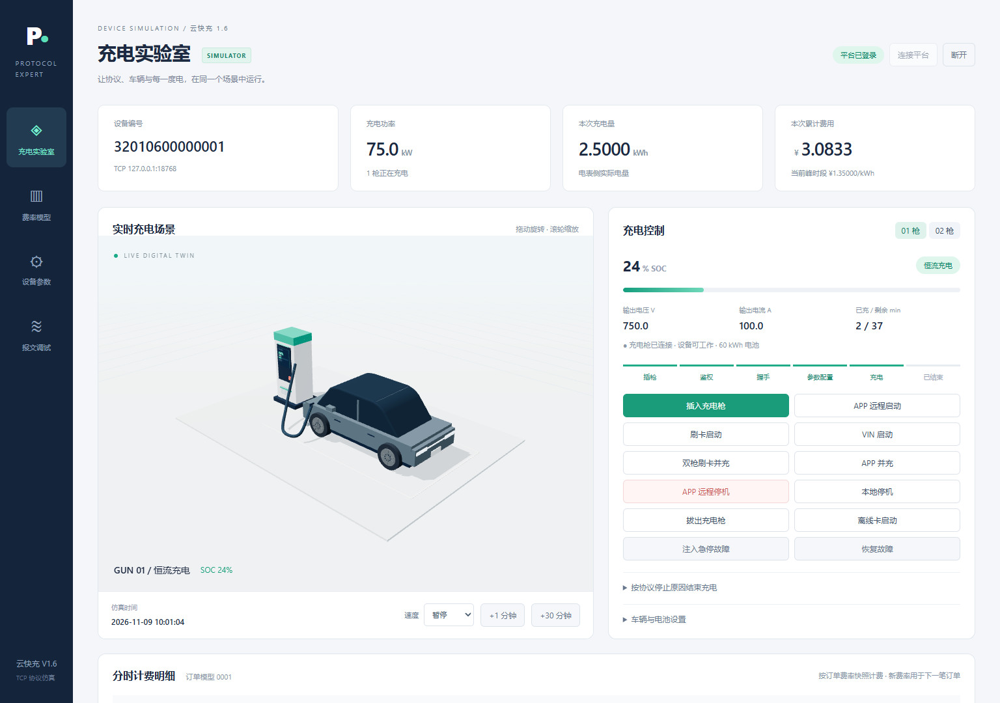
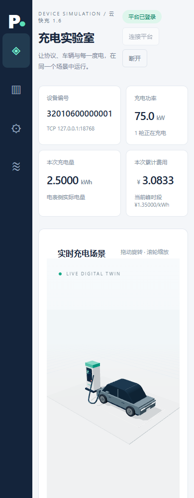

# 验收记录

## 2026-11-11 三服务重构验收

- 构建：`mvn -B package` 与 `mvn -B test` 均 BUILD SUCCESS；codec 19 项、protocol 3 项、simulator 15 项，共 37 项，失败 0。
- 中间件：服务器 PostgreSQL 16.14（`ipe-postgres`，端口 55432），空库由 Flyway `V1__init.sql` 建表并写入演示数据。
- 云快充链路：模拟器从平台选桩 → 登录 → 插枪 → 0x31 → 实时计量 → 停止 → 0x3B；订单 `SETTLED`，账单 `DEVICE_BILL`（38.6468 kWh / 42.5115 元）。
- OCPP 链路：同站点同文本编号设备 → BootNotification → 平台远程启动 → StartTransaction → MeterValues → StopTransaction；订单 `SETTLED`，账单 `PLATFORM_ESTIMATE`（18.839 kWh / 20.7229 元）。
- 设备隔离：切换后仅 OCPP 设备在线，云快充设备离线；订单与账单继续归属原平台设备 ID。
- 命令：`remote-start` 命令记录 `SUCCESS`，设备随后上报 StartTransaction。
- 站点统计：2 笔订单、电量 57.4858、订单金额 63.2344、桩账单 42.5115、平台估算 20.7229。
- 排障：按订单号定位设备/订单，时间线确认 0x3B、0x40、账单，最后有证据环节为「交易记录确认 0x40」。
- OTLP：运维平台 trace 已进入 Tempo；Loki 当前未返回标签，排障明确提示日志证据不足。
- 启动脚本：`scripts/start-local.ps1` 依次启动 ops/protocol/simulator；`stop-local.ps1` 可停止三端。

详细步骤与接口见 [运维平台与排障](ops-platform.md)。

## 历史验收（2026-11-09，重构前）

日期：2026-11-09，Asia/Shanghai。工具：指定JDK21、Maven3.8.8、真实Netty TCP服务和客户端、Playwright Chromium。

## 编译和测试

执行 `mvn -B package`，BUILD SUCCESS。平台17项、模拟器15项，共32项，失败0、错误0、跳过0。测试内容：

| 测试类 | 项数 | 验证重点 |
|---|---:|---|
| FrameCodecTest | 8 | 文档样例、CRC、BCD、费率、实时、交易、3DES |
| FrameStreamDecoderTest | 3 | 半包、粘包、非法CRC |
| BmsFramesTest | 2 | 八类过程帧字节长度、字段往返、偏移、温度、打包组号与截断拒绝 |
| ProtocolCoverageTest | 2 | 全部51帧的结构化解码，逐一明文/3DES封装，200字节上限 |
| SessionRegistryTest | 2 | 同类型并发命令逆序应答按序列号关联、旧连接不能注销新会话 |
| ChargingLedgerTest | 3 | 跨时段、跨午夜与计损、3600次积分无逐秒舍入漂移 |
| SimulatorRuntimeTest | 12 | 完整阶段、SOC满电、离线充电、补启动、功率/故障、并充成功/失败、费率快照、断电恢复、确认重试、无故障恢复不能停止充电、BMS超时错误位 |

## 真实TCP联调

使用隔离H2及模拟器状态文件（位于 `tmp/integration/`）。平台HTTP29080/TCP18768；明文模拟器HTTP29081、桩号32010600000001；加密模拟器HTTP29082、桩号32010600000002。加密实例验证完成后停止。没有使用外部云快充服务器。

明文、3DES各验证：

- 登录→模型校验→请求/接收费率。
- APP启机→握手/参数→分时计费→APP停机→交易→确认移除待传队列。
- 09:59:00开始，4秒准备，推进124秒：电量2.5000kWh，费用3.0833元；包含平、峰两段。
- 读取实时的应答序列号匹配；费率主动下发；工作功率限制。
- 白名单同步，存在/不存在卡查询；断网离线卡启充、结束、联网补传成功。
- APP双枪并充，两枪均充电，独立流水与独立账单。

补充真实联调通过：平台对时、零卡号更新余额/错误卡号拒绝、清除卡后查询不存在、升降地锁、升级成功/下载超时两场景、VIN/刷卡启动交易标志、35张卡自动分批同步/查询/清除、未插枪后60秒窗口内补启动、空闲重启。

可复用核心回归脚本：`scripts/smoke-test.py --base-url http://127.0.0.1:29081`。此脚本会修改目标实例状态，只对隔离测试实例运行。

## 浏览器交互

- 桌面1536px及手机390px：无横向溢出，无JavaScript页面错误。
- WebGL真实渲染，摄像机随窄屏调整视角，保留完整桩车构图。
- 点击读取平台费率→保存并下发，确认0x57成功。
- 点击插枪→APP启动→两次推进1分钟→分时账单→APP停机。
- 协议目录加载51项，选0x15可查看字段元数据。
- 平台多枪选择器可切到02枪。

界面预览：

## 实现范围

通过的是规范字段、仿真状态、参考平台业务与本地网络闭环验证，未进行真实桩CAN/BMS硬件测试或云快充正式接入认证。参考鉴权不接支付账户；升级只仿真结果。协议正文与附录冲突处理详见 `protocol-decisions.md`。

## 3D视觉升级补充验收

2026-11-09完成曲面车身、慢速插拔枪、AC/DC能流、底盘电池透视。14项前端检查通过，记录见 `scene-v2-browser-checks.json`，包括850毫秒时插枪仍在缓动、启机等待连接器就位、充电渐隐、真实SOC联动、故障断流、待机不伪造能流、手机无横向溢出、减少动态效果偏好和无JavaScript错误。

重新打包BUILD SUCCESS；逐字节核对JAR内场景脚本、样式、模型、加载器及署名与源码一致，模型SHA256与资产清单一致；从重新启动后的JAR服务实际打开并渲染成功。新预览见 `scene-v2-charging.png`、`scene-v2-exterior.png`。
